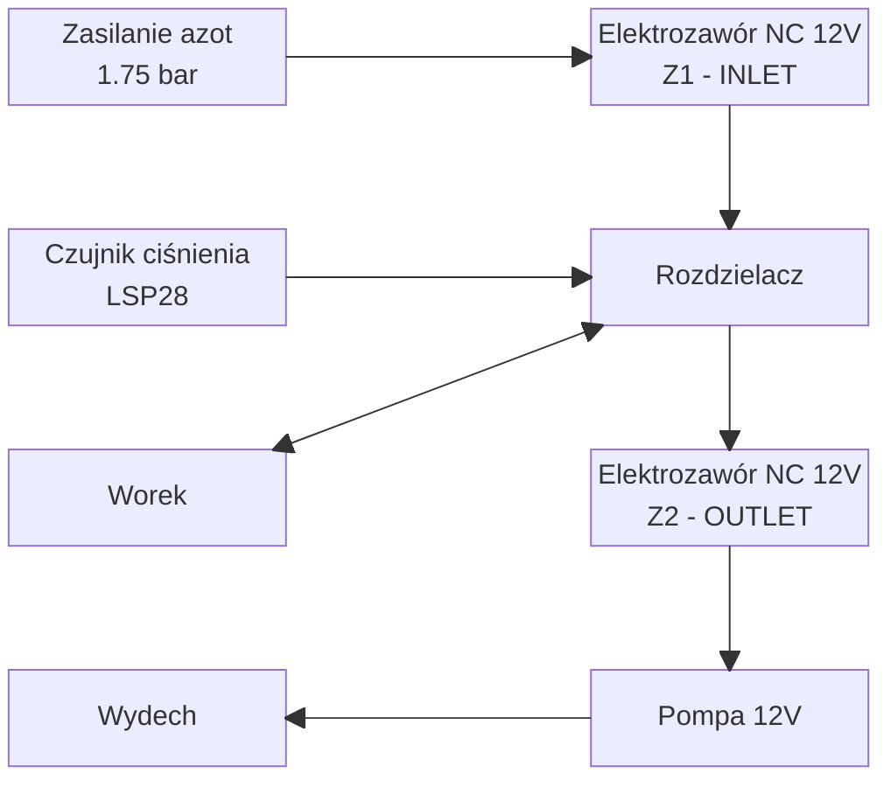

# Automatyzacja płukania worków

Urządzenie automatyzuje płukanie worków azotem. Steruje dwoma zaworami
elektromagnetycznymi i pompą: najpierw napełnia worek, a następnie go
opróżnia, aż do wykrycia odcięcia lub upływu limitu czasu.

**Najważniejsze funkcje**

- automatyczne cykle napełniania i opróżniania (1–99 cykli),
- wykrywanie końca opróżniania na podstawie czujnika ciśnienia LPS28DFW
  lub prądu pompy mierzonego przez INA219,
- obsługa wyświetlacza OLED 128×64, enkodera oraz przycisków START, STOP i
  ręcznego napełniania/opróżniania,
- kalibracja czasów i prądu pompy oraz ukryty tryb testowy z parametrami
  odcięcia,
- ustawienia zapisywane w emulowanej pamięci EEPROM,
- sygnalizacja dźwiękowa (start, błąd, zakończenie).

## Użytkowanie

1. Na ekranie głównym ustaw liczbę cykli oraz czasy napełniania i
   opróżniania. Obrót enkodera wybiera pole, naciśnięcie rozpoczyna edycję,
   ponowne naciśnięcie zatwierdza wartość.
2. Opcjonalnie wykonaj kalibrację czasów w menu ustawień (ręczne przytrzymanie
   przycisków, pomiar zapisywany w EEPROM).
3. Przycisk START rozpoczyna procedurę, STOP natychmiast ją przerywa i wyłącza
   wyjścia.
4. Ręczne przyciski napełniania i opróżniania działają na ekranie głównym. Nie
   należy ich wciskać jednocześnie.

## Hardware

### Układ pneumatyczny

### Elektronika

- **Mikrokontroler:** Raspberry Pi Pico (RP2040), firmware w Arduino
  (`rp2040:rp2040:rpipico`).
- **Wyświetlacz:** OLED SSD1306 128×64, I2C, adres `0x3C`.
- **Wejścia:** enkoder z przyciskiem, przyciski START, STOP oraz ręcznego
  napełniania i opróżniania.
- **Wyjścia:** Z1 (napełnianie), Z2 (opróżnianie), pompa 12 V oraz brzęczyk.
- **Czujniki:** INA219 (prąd pompy, I2C `0x40`) i LPS28DFW (ciśnienie w
  układzie, I2C `0x5C` lub `0x5D`). Oba działają na wspólnej magistrali I2C.

Pełne mapowanie GPIO znajduje się w
[dokumentacji firmware](./Firmware/flush-automation/README.md#połączenia-sprzętowe).

## Software

Firmware znajduje się w katalogu `Firmware/flush-automation/`. Program jest
nieblokujący: pętla główna obsługuje wejścia, ekran, automat procedury i zapis
konfiguracji. Szczegółowy opis architektury jest w
[README firmware](./Firmware/flush-automation/README.md).

### Interfejs i nawigacja

- **Ekran główny:** wybór i edycja cykli, czasów napełniania i opróżniania
  oraz wejścia do ustawień.
- **Ekran statusu:** bieżąca faza, numer cyklu, czas i pasek postępu względem
  limitu czasu.
- **Menu ustawień:** powrót, kalibracja czasów, maksymalne czasy napełniania i
  opróżniania oraz potwierdzenie resetu programowego.
- **Tryb testowy:** włączany przez uruchomienie urządzenia z wciśniętym STOP.
  Pięć stron zawiera diagnostykę czujników, kalibrację prądu pompy oraz
  parametry odcięcia (próg ciśnienia, metoda, filtr prądu, liczba próbek).

### Automat procedury

Procedura zaczyna się od wstępnego opróżniania, a każdy z cykli składa się z
napełniania (Z1) i opróżniania (Z2 i pompa). Pompa pracuje podczas opróżniania
do wykrycia odcięcia lub upływu `empty_time`. Start procedury nie wykonuje kalibracji;
używa danych zapisanych w EEPROM. Zakończenie procedury
sygnalizowane jest serią sygnałów dźwiękowych.

### Wykrywanie odcięcia

Metodę wybiera się w trybie testowym:

- **`CISNIENIE`** (domyślnie): odcięcie, gdy przez 10 kolejnych próbek (1 s)
  ciśnienie jest niższe niż próg (domyślnie 850 hPa).
- **`PRAD`**: prąd pompy jest filtrowany i wygładzany. Odcięcie zgłaszane jest,
  gdy prąd osiągnie połowę drogi między wartością przy otwartym i zamkniętym
  zaworze albo gdy jego narost przekroczy połowę wartości z kalibracji.
  Pomiar jest wstrzymywany po włączeniu i wyłączeniu pompy, aby pominąć
  skoki rozruchowe.
- **`OBA`**: odcięcie zgłaszane przez dowolną z dwóch metod.

Jeśli wybrana metoda nie ma poprawnego odczytu lub kalibracji, odcięcie nie
następuje, a krok kończy się limitem `empty_time`.

## Struktura projektu

| Ścieżka | Zawartość |
| --- | --- |
| `README.md` | Ten opis projektu. |
| `Firmware/flush-automation/` | Kod firmware (C/C++ dla Arduino RP2040). |
| `Firmware/flush-automation/*.ino`, `Ui.*`, `Procedure.*`, `ConfigStore.*` | Punkt wejścia, interfejs, automat procedury i konfiguracja w EEPROM. |
| `Firmware/flush-automation/Ina219.*`, `Lps28dfw.*` | Sterowniki czujników prądu i ciśnienia. |
| `Firmware/flush-automation/*Bitmaps.h` | Bitmapy ekranów i cyfr wyświetlacza. |
| `Firmware/flush-automation/UI/` | Źródłowe pliki PNG ekranów. |
| `Firmware/flush-automation/chips/`, `diagram.json`, `wokwi.toml` | Pliki z wczesnej fazy projektu, używane do testów w symulatorze Wokwi (nie opisują fizycznego układu). |
| `Firmware/flush-automation/install.bat`, `compile.bat`, `libraries.txt` | Instalacja zależności i kompilacja (arduino-cli). |
| `Projekt UI/` | Projekty grafik ekranów (GIMP `.xcf`) i wyeksportowane PNG. |
| `Schemat/` | Schemat urządzenia (`air-flushing-controller.epro2`). |

### Budowanie

1. Uruchom `Firmware/flush-automation/install.bat`, aby zainstalować platformę
   RP2040 i wymagane biblioteki (wymaga arduino-cli).
2. Uruchom `Firmware/flush-automation/compile.bat`, aby zbudować plik
   `build/flush-automation.ino.uf2`.

